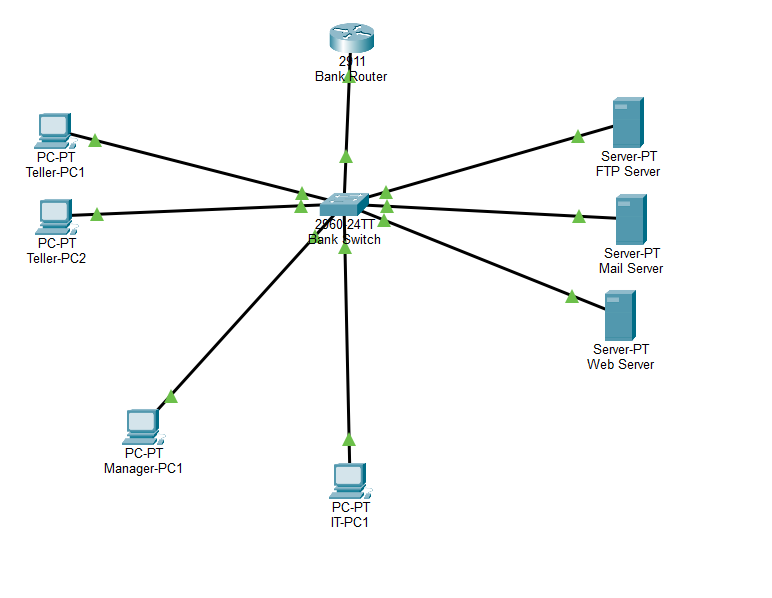

# Bank Branch Network (Cisco Packet Tracer)

A segmented bank-branch network built in Cisco Packet Tracer: VLAN isolation, router-on-a-stick inter-VLAN routing, centralized server services (web, mail, FTP) and role-based extended ACLs.



## Documentation guide

- **[docs/BANK_BRANCH_NETWORK_REPORT.docx](docs/BANK_BRANCH_NETWORK_REPORT.docx)**: the full project documentation (design, step-by-step configuration, ACL policy, verification).
- **Markdown docs in `docs/`**: quick reference versions: [security policy](docs/security-policy.md), [testing guide](docs/testing.md), [troubleshooting](docs/troubleshooting.md), [lab credentials](docs/credentials.md) and [known issues](docs/known-issues.md).

## Highlights

- 4 VLANs (Teller, Manager, IT Staff, Servers) on a Cisco 2960 switch
- Router-on-a-stick on a Cisco 2911 using 802.1Q sub-interfaces
- Role-based extended named ACLs applied inbound on each user VLAN
- Hardened switch: unused ports shut down, unused native VLAN (99) on the trunk, PortFast on access ports
- Centralized services in VLAN 40: Web (HTTP/HTTPS + DNS), Mail (SMTP/POP3), FTP

## Addressing

| VLAN | Name | Subnet | Gateway |
|------|------|--------|---------|
| 10 | TELLER | 192.168.10.0/24 | 192.168.10.1 |
| 20 | MANAGER | 192.168.20.0/24 | 192.168.20.1 |
| 30 | IT_STAFF | 192.168.30.0/24 | 192.168.30.1 |
| 40 | SERVERS | 192.168.40.0/24 | 192.168.40.1 |

| Device | VLAN | IP | Gateway |
|--------|------|----|---------|
| Teller-PC1 | 10 | 192.168.10.10 | 192.168.10.1 |
| Manager-PC1 | 20 | 192.168.20.10 | 192.168.20.1 |
| IT-PC1 | 30 | 192.168.30.10 | 192.168.30.1 |
| Web / DNS server | 40 | 192.168.40.10 | 192.168.40.1 |
| Mail server | 40 | 192.168.40.20 | 192.168.40.1 |
| FTP server | 40 | 192.168.40.30 | 192.168.40.1 |

Switch ports: Fa0/1-5 VLAN 10, Fa0/6-10 VLAN 20, Fa0/11-15 VLAN 30, Fa0/16-20 VLAN 40, Gi0/1 trunk to the router (VLANs 10,20,30,40; native 99). Fa0/21-24 and Gi0/2 are shut down.

## Repository layout

```
.
├── README.md
├── configs/
│   ├── running/    # exported show running-config (sanitized)
│   └── setup/      # paste-ready CLI scripts to rebuild the lab
├── servers/
│   ├── web/        # index.html served by the web server
│   ├── mail/       # mail server settings
│   └── ftp/        # FTP server settings
├── docs/
│   ├── BANK_BRANCH_NETWORK_REPORT.docx   # full project documentation
│   ├── credentials.md
│   ├── security-policy.md
│   ├── testing.md
│   ├── troubleshooting.md
│   ├── known-issues.md
│   └── images/
└── packet-tracer/  # Bank.pkt, the Packet Tracer topology
```

## Quick start

1. Open Packet Tracer and build the topology (2911 router, 2960 switch, 3 PCs, 3 servers) or open `packet-tracer/Bank.pkt`.
2. Paste `configs/setup/SW-BANK.setup.txt` into the switch CLI.
3. Paste `configs/setup/R-BANK.setup.txt` into the router CLI. If IOS says RSA keys already exist, keep them and continue.
4. Configure the servers as described in `servers/`.
5. Give each PC a static IP and gateway from the table above, then run the checks in `docs/testing.md`.

## Security model

Least privilege: every VLAN may reach the web server; only IT Staff may reach FTP and use SSH/Telnet; tellers and managers cannot reach each other or the management plane. Details in [docs/security-policy.md](docs/security-policy.md).

## Notes

This is a lab design; the credentials listed are Packet Tracer lab accounts only. See [docs/known-issues.md](docs/known-issues.md) for hardening that would be needed beyond a lab.
