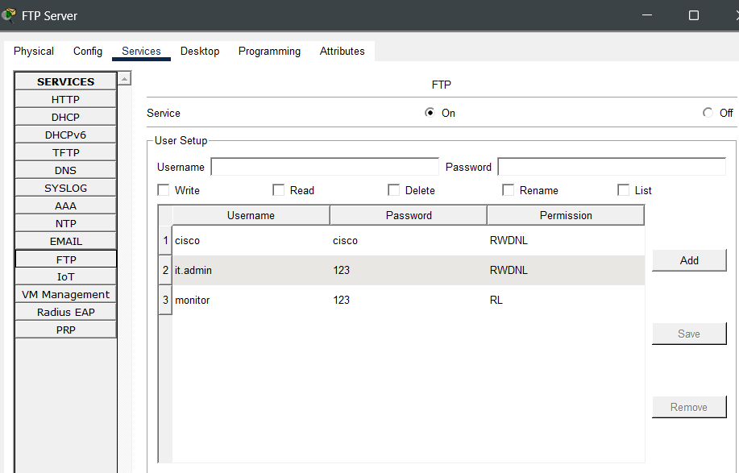

# FTP Server (192.168.40.30)

Packet Tracer: Services > FTP, service On.

| Username | Password | Permissions |
|----------|----------|-------------|
| cisco | cisco | Read, Write, Delete, Rename, List |
| it.admin | 123 | Read, Write, Delete, Rename, List |
| monitor | 123 | Read, List |

Teller and Manager users are intentionally not created on this server, so FTP is denied at the network layer (ACL) and at the application layer.

