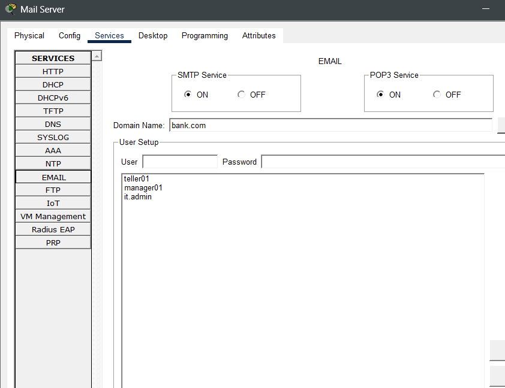

# Mail Server (192.168.40.20)

Packet Tracer: Services > EMAIL

- SMTP service: On
- POP3 service: On
- Domain name: `bank.com`

| User | Password |
|------|----------|
| teller01 | 123 |
| manager01 | 123 |
| it.admin | 123 |

Client setup on each PC (Desktop > Email): email address `<user>@bank.com`, incoming and outgoing server `192.168.40.20`.

