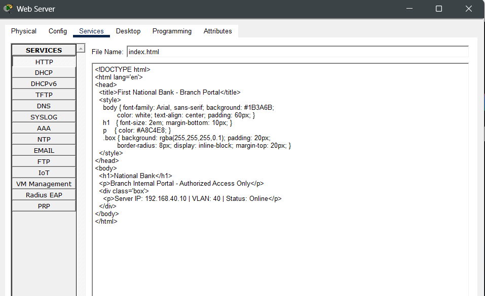

# Web / DNS Server (192.168.40.10)

Packet Tracer: Services > HTTP, replace `index.html` with `index.html` from this folder. HTTP and HTTPS are On. The same server answers DNS queries (UDP/TCP 53) that the ACLs permit.

No login is required for the portal page.
